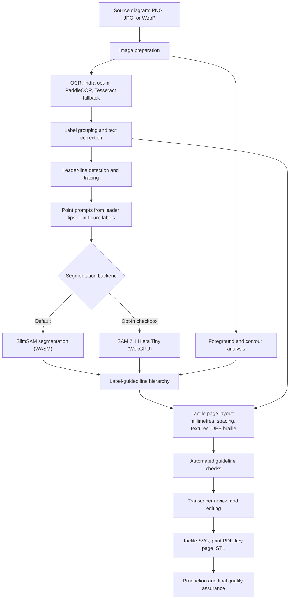

# TactiDiagram

**A production-oriented drafting tool for tactile graphics transcription.**

TactiDiagram helps a braille transcriber turn a labeled textbook or instructional diagram into an editable first draft of a tactile graphic. It automates the image-analysis and page-layout work—reading printed labels, tracing the leader lines that identify diagram parts, segmenting those parts, and laying out braille and tactile features—so the transcriber can spend more time reviewing the content and less time building every graphic from scratch.

The transcriber remains responsible for the finished graphic. TactiDiagram is an assistive production tool, not an autonomous replacement for professional transcription, accessibility review, or testing with tactile readers.

- **Application:** Run it directly from the repository, or install a packaged
  desktop build from [Releases](https://github.com/mrhunsaker/TactiDiagram/releases).
  It is not hosted on GitHub Pages.
- **User and technical documentation:** https://mrhunsaker.github.io/TactiDiagram/
- **Getting started:** [docs/getting-started.md](docs/getting-started.md)
- **Every application setting and action:** [docs/application-options.md](docs/application-options.md)
- **Theory and pipeline:** [docs/architecture.md](docs/architecture.md), [docs/pipeline.md](docs/pipeline.md)
- **Models and inference engines:** [docs/models-and-engines.md](docs/models-and-engines.md)
- **WebGPU browser setup:** [docs/webgpu.md](docs/webgpu.md)
- **OCR engines (optional Indra engine):** [docs/ocr-engines.md](docs/ocr-engines.md)
- **Research roadmap (other models not implemented):** [docs/advanced-model-options.md](docs/advanced-model-options.md)
- **Review workflow:** [docs/review-workflow.md](docs/review-workflow.md)

## Intended workflow

The primary user is a braille transcriber or teacher of students with visual impairments (TVI) preparing tactile graphics from labeled science, geography, and other instructional diagrams.

A typical job begins with a diagram from a textbook, worksheet, or other instructional source. The application analyzes the diagram and creates a first-draft tactile page. The transcriber reviews the detected wording, part boundaries, braille, spacing, textures, and overall readability; makes corrections in the editor; and exports the result for production and final quality assurance.

The goal is not to automate professional judgment. It is to provide a consistent, standards-informed starting point that a transcriber can inspect, correct, and finish.

## Processing workflow

The image-analysis stages are deliberately ordered. The diagram's labels provide semantic anchors: the system reads the text, follows the leaders to the parts being named, and uses those locations to guide segmentation and tactile rendering. It does not simply convert every visible edge into a raised line.



TactiDiagram has three distinct processing paths. The standard segmented tactile output is the default. Optional Autotrace reconstructs a raster before OCR and segmentation. Optional direct Potrace SVG output runs the full analysis and tactile layout, then replaces segmented artwork with editable monochrome object outlines traced from the original source. The direct SVG has a transparent background and independent braille-label layers. See [Pipeline stages](docs/pipeline.md).

## Processing modes and output paths

1. **Standard segmented output (default):** OCR identifies labels; leader-line geometry links labels to the drawing; foreground/structural analysis and point-prompted SAM segmentation identify named parts; the renderer builds the tactile page from part masks, structural lines, optional textures, braille, and keys.
2. **Autotrace preprocessing (optional):** Potrace reconstructs a raster before analysis. That raster feeds OCR, leader detection, foreground/line analysis, and segmentation. The original upload remains available for comparison. The standard segmented renderer still creates the tactile page.
3. **Direct Potrace SVG output (optional):** full analysis and segmentation still run. The layout engine places braille and keys normally. A separate pass traces the original source into black vector outlines on transparency: it masks OCR label boxes, computes per-channel RGB Sobel edge strength, applies a bounded Otsu threshold, and passes a binary edge map to Potrace. The trace replaces segmented diagram artwork in the primary SVG, while analysis overlays remain available.

**Use letter keys for every label** forces each placed label to a unique two-letter alphabetic braille key and retains the standard key-page mapping. Direct Potrace output honors this option. Its layered export separates Potrace linework, the braille title, and every label's braille into independently editable Inkscape layers. Source colours and fills are intentionally omitted. Potrace can simplify small details, and OCR masking can suppress nearby contours.

See [Application controls](docs/application-options.md), [Pipeline stages](docs/pipeline.md), and [Models and inference engines](docs/models-and-engines.md#potrace-and-autotrace).

## What the application produces

- **Tactile graphic:** a page laid out in physical millimetres, with a bold/fine line hierarchy, optional textures, and uncontracted UEB Grade 1 braille.
- **Key page:** a legend for two-letter label keys when full braille labels do not fit.
- **3D relief preview:** a view of the raised lines and braille, plus STL export for 3D printing.
- **Production files:** tactile SVG (pure black, suitable for swell-paper workflows), key page, and print/PDF at true page size.
- **Review information:** detected labels, OCR corrections, leader-line and segmentation overlays, and automated checks alongside a simple edge-tracing baseline.

## Transcriber review is part of the process

The generated page is a draft that must be checked against the source diagram. In particular:

1. Verify every label and its relationship to the correct diagram part.
2. Correct OCR errors and remove labels that should not appear; merge labels split across lines.
3. Inspect leader paths, segmentation boundaries, and the named-part line hierarchy.
4. Check braille placement, clearance, line spacing, texture distinctions, and the key page.
5. Review the 3D relief preview where available, then export and follow the applicable production and quality-assurance process.

See [The transcriber review workflow](docs/review-workflow.md), [Tactile layout and BANA guidelines](docs/guidelines.md), and [Printing and swell paper](docs/printing.md).

## Standards, evaluation, and limitations

Layout and checking are informed by the BANA *Guidelines and Standards for Tactile Graphics* (2022), ICEB *Rules of Unified English Braille*, and Library of Congress Spec 800 braille dimensions. The application uses physical page dimensions and checks including braille clearance, short fragments, and areas where lines are closer than 3 mm.

In an evaluation of 16 Wikimedia Commons diagrams, the current benchmark reported 148 of 151 hand-counted labels found (98%). The evaluation also measured braille placement, short fragments, and close-line areas against an edge-tracing baseline. See [Evaluation and benchmarks](docs/evaluation.md) for the method, per-diagram results, and reproduction instructions.

These measurements are automated checks, not evidence of validated tactile usability. TactiDiagram has not yet been formally tested with blind readers or systematically validated on physical swell-paper output. Labels are uncontracted UEB. Diagrams without printed labels (or with only math symbols) may receive outlines without named-part labels. OCR can miss text on busy fills; the transcriber can correct detected wording but cannot currently add a label the system failed to detect. Professional review remains necessary.

## Privacy and deployment

TactiDiagram is a static, browser-based application. OCR, segmentation, layout, checking, rendering, and 3D preview run on the user's device. There is no application backend, account, or image-upload service; source diagrams are not sent to a server. Model and library assets are prepared locally with `npm run vendor`; GitHub Pages publishes documentation only.

This design supports use with school and student materials while keeping source images on the transcriber's computer. See [Architecture](docs/architecture.md) and [Deployment](docs/deployment.md).

## Run locally

Requirements: Node.js 24 or newer and a **Chromium-based desktop browser** (Chrome, Edge, Brave, Chromium) for the recommended experience. Firefox can run the standard application with SlimSAM, but TactiDiagram deliberately disables its optional SAM 2.1 backend there because of an ONNX Runtime WebGPU compatibility issue—even though Firefox itself has WebGPU on some platforms. Safari and other WebKit browsers are not supported application targets. WebGL is needed only for the 3D relief view and STL export.

```bash
npm ci
npm run vendor
npm run serve
```

The vendor step copies browser libraries into `src/vendor/` and downloads model assets into `src/models/`, including the optional SAM 2.1 model files (about 78 MB). SAM 2.1 is an experimental, optional path: Chrome and Edge are the recommended browsers, and Brave/other Chromium builds may work if they expose a compatible WebGPU adapter and ONNX Runtime can execute the model. Enable browser hardware acceleration, restart, and check `chrome://gpu` or `edge://gpu`. Firefox is deliberately routed to SlimSAM because the current ONNX Runtime WebGPU backend is not reliable there; Safari/WebKit is not a supported application target. If WebGPU is missing, SAM 2.1 initialization fails, or inference fails, TactiDiagram automatically selects or retries segmentation with SlimSAM. The local server serves `src/` directly at http://localhost:5173 by default; localhost is a secure context for WebGPU. Keep the terminal open while using the app.

For browser-specific setup, GPU diagnostics, Firefox behavior, and troubleshooting, see the [WebGPU setup guide](docs/webgpu.md). The application can use its default WASM segmentation backend without WebGPU; SAM 2.1 is optional.

There are three ways to run TactiDiagram:

1. **Browser tab** (`npm run serve`, above): the simplest; everything runs in
   your browser at http://localhost:5173.
2. **Desktop window from the repository** (no installation):

   ```bash
   npx neu update
   npm run desktop
   ```

   This opens the same app in an application window with a taskbar/dock icon
   and no browser chrome, using the operating system webview instead of a
   bundled Chromium.
3. **Install a packaged desktop build** (no Node.js on the target machine):
   download the x86_64 Linux AppImage or Windows x64 NSIS installer from
   [Releases](https://github.com/mrhunsaker/TactiDiagram/releases). The Windows
   installer creates desktop and Start Menu shortcuts and an uninstaller;
   the portable ZIP remains available. Linux requires system WebKitGTK;
   Windows requires Microsoft Edge WebView2 Runtime.
   See [Desktop app and packaging](docs/desktop-gui.md).

To run the automated evaluation harness:

```bash
npm run eval
```

The evaluation harness uses Playwright; install its Chromium browser if it is not already available:

```bash
npx playwright install chromium
```

See [Getting started](docs/getting-started.md) for setup and [Application controls and options](docs/application-options.md) for the meaning and effect of every UI control, result view, review action, and export. For the processing sequence, see [Pipeline stages](docs/pipeline.md); for the model inventory, see [Models and inference engines](docs/models-and-engines.md). Future research candidates are described separately in [Advanced model options](docs/advanced-model-options.md); they are not implemented application controls.

## Project structure

```
src/                  browser application
  index.html          application shell
  css/                application styles
  js/                 OCR, leaders, segmentation, layout, rendering, UI
  samples/            sample diagrams and source attributions
  precomputed/        precomputed sample outputs
  fonts/              self-hosted fonts
scripts/              vendor build, local server, evaluation and QA tooling
docs/                 user and technical documentation (MkDocs)
.github/workflows/    documentation deployment (Pages) and desktop release builds
```

Key implementation modules are documented in [docs/modules.md](docs/modules.md). The processing sequence is described in [docs/pipeline.md](docs/pipeline.md).

## Contributing and project maintenance

Contributions are welcome, particularly bug reports and improvements grounded in actual transcription work. Please include a representative source diagram when possible (with permission to share it), describe the expected tactile result, and explain what the current output gets wrong. Changes to OCR, tracing, segmentation, layout, or export should include before-and-after evaluation results where practical.

- [Contributing guide](CONTRIBUTING.md)
- [Code style](CODE_STYLE.md)
- [Code of conduct](CODE_OF_CONDUCT.md)
- [Security policy](SECURITY.md)
- [Change history](CHANGES.md)
- [Documentation contribution guide](docs/contributing.md)

## Credits and licensing

TactiDiagram builds on open-source OCR, computer-vision, segmentation, and rendering libraries, including Indra OCR (optional engine), PaddleOCR, Tesseract.js, SlimSAM, experimental SAM 2.1, Transformers.js, ONNX Runtime Web, OpenCV.js, three.js, and Potrace. See the project dependency manifests and relevant upstream projects for their respective licenses.

The application code is licensed under **GPL-3.0-or-later**. Sample diagrams retain their source licenses; attribution is maintained in [src/samples/CREDITS.md](src/samples/CREDITS.md). The precomputed tactile SVGs retain the licenses of their source diagrams.

## Editable SVG post-processing and quality control

The tactile SVG export is a vector document with physical dimensions in millimetres. It contains separate, named SVG groups for the page background, textures, structural line art, outlines, label-clearance knockouts, leader lines, and braille dots. The key-page SVG also separates braille from sighted print-reference text. Paths, circles, and text remain vector objects rather than a flattened screenshot.

**Inkscape is the recommended reference editor because it is free and open-source (FOSS).** The exported SVG is standard vector artwork; other SVG-capable editors—including Adobe Illustrator and Affinity Designer—can also be used. TactiDiagram targets FOSS workflows, so Inkscape is the editor used in these instructions, not a technical requirement.

Recommended post-processing sequence:

1. Export the editable tactile SVG and, when present, the key-page SVG.
2. Open the SVG in Inkscape. Use the Objects/Layers panel to inspect and isolate the named groups.
3. Compare the artwork with the source diagram and the TactiDiagram analysis views. Correct path geometry, remove false contours, reconnect broken boundaries, and adjust leader placement where necessary.
4. Check label-to-part correspondence, braille spelling and dot patterns, line hierarchy, texture distinction, clearances, and page margins. Do not assume that a visually attractive edit is tactilely legible.
5. Preserve the physical page dimensions and millimetre scale. Avoid scaling individual objects in ways that alter specified braille or line dimensions.
6. Save a separate reviewed SVG, then produce a physical proof on the target printer/swell-paper/fuser system. Inspect the raised output and obtain tactile-reader feedback where possible.

The vector editor is a post-processing and QC option, not an automated validation step. Editing SVG geometry does not update TactiDiagram's analysis state or its automated guideline report. Re-run or independently perform checks after edits, and retain the unmodified export so changes can be compared or reverted.

## Component licenses

TactiDiagram application code is licensed under **GPL-3.0-or-later**. The
third-party components it uses, runs, or downloads carry their own licenses,
listed here at the component level. Full license texts included in the
repository are in the `LICENSES/` directory and alongside the downloaded
model assets; the samples' per-image attribution is in
[src/samples/CREDITS.md](src/samples/CREDITS.md).

| Component | Role | License | License source |
|---|---|---|---|
| Atkinson Hyperlegible (woff2) | Self-hosted accessibility font, `src/fonts/` | SIL Open Font License 1.1 | [Braille Institute](https://www.brailleinstitute.org/freefont/) |
| esm-potrace-wasm / Potrace | Optional Autotrace preprocessing and direct monochrome SVG outline tracing | GPL-2.0-or-later (Potrace) | vendored with its license notice; `LICENSES/GPL-2.0.txt` |
| Indra OCR models (opt-in engine) | `det.onnx`, `rec.onnx`, `meta.json` | **AI Pub-Open RAIL-M (modified), not GPL** — see note below | `src/models/indra/LICENSE` (downloaded) |
| ONNX Runtime Web | Executes the OCR and segmentation ONNX models in the browser | MIT | [microsoft/onnxruntime](https://github.com/microsoft/onnxruntime/blob/main/LICENSE) |
| OpenCV.js | Classical image processing, contours, Hough, checks | Apache-2.0 | [@techstark/opencv-js](https://www.npmjs.com/package/@techstark/opencv-js), OpenCV 4.12.0 |
| PaddleOCR ONNX (RapidOCR conversions) | Primary OCR detector + English recognizer | Apache-2.0 | [RapidAI/RapidOCR](https://www.modelscope.cn/models/RapidAI/RapidOCR) (upstream PaddleOCR: Apache-2.0) |
| Playwright (dev only) | Evaluation and QA harness, not shipped to users | Apache-2.0 | [microsoft/playwright](https://github.com/microsoft/playwright/blob/main/LICENSE) |
| Sample diagrams | `src/samples/` | Per-image: Public domain / CC0 / CC BY / CC BY-SA | `src/samples/CREDITS.md` |
| SlimSAM (Xenova ONNX port) | Point-prompted segmentation of labeled parts | Apache-2.0 | [Xenova/slimsam-77-uniform](https://huggingface.co/Xenova/slimsam-77-uniform) |
| Tesseract.js + core + `eng.traineddata` | Fallback OCR engine and English data | Apache-2.0 | [naptha/tesseract.js](https://github.com/naptha/tesseract.js#license); data: Tesseract 4.0.0 tessdata (Apache-2.0) |
| three.js | 3D relief preview and STL export | MIT | [mrdoob/three.js](https://github.com/mrdoob/three.js/blob/dev/LICENSE) |
| Transformers.js (Hugging Face) | Loads and runs SlimSAM in the browser | Apache-2.0 | [huggingface/transformers.js](https://github.com/huggingface/transformers.js/blob/main/LICENSE) |

**Note on the Indra weights.** Unlike every other model asset in this project,
the Indra OCR model files are distributed by Datalab under a modified
AI Pub-Open RAIL-M license, not a standard open-source license. Vendoring
them for local use appears consistent with the license's use-and-attach
terms, but redistribution inside a GPL-3.0-or-later distribution (including
derivative builds of this project) should be checked against the full text in
`src/models/indra/LICENSE` before shipping. If redistribution is not
permitted for your use case, delete `src/models/indra/` and leave the
"Use Indra OCR" checkbox off: the engine chain falls back to PaddleOCR and
then Tesseract with no loss of function. See
[docs/ocr-engines.md](docs/ocr-engines.md#licensing-and-redistribution).
