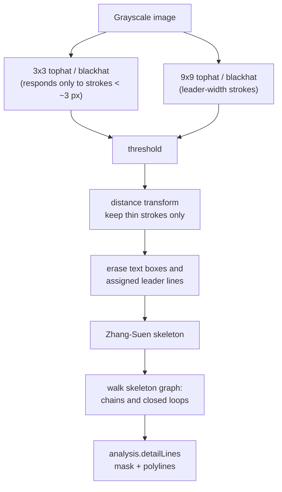

# Fine exterior lines

Some of the most tactically important linework in a diagram is also the
finest: vessel outlines just outside a labelled organ, hairline external
boundaries, thin leader-adjacent contour detail. These lines are finer than
the arrows and leader lines, and the pipeline's own stages are angled against
them: the thin-stroke mask in `leaders.js` exists to *remove* thin strokes so
leaders can be found, and the structure line art (`lineart.js`) is built from
colour-region boundaries and medium-scale strokes at reduced working
resolution, so faint external detail is often dropped.

The fine-line tracer in this project keeps that linework deliberately.

## How it works

`src/js/fine-lines.js`, called from the analysis pipeline as the
`fine_lines` stage and exposed as `analysis.detailLines`:



Design points:

- **Two scales separate detail from leaders.** A 3x3 morphological kernel
  cannot respond to a stroke wider than the kernel, so what survives it *is*
  fine detail; the wider kernel's comparison then removes pixels that belong
  to genuinely thicker strokes.
- **Width, not just darkness.** A distance transform classifies surviving
  pixels by their half-width, so a dark but thick line (already covered by
  the region-boundary line art) is not duplicated.
- **Curves survive as curves.** The skeleton graph is walked from endpoints
  and around closed loops into whole polylines, instead of Hough's short
  straight fragments; junctions are natural cut points.
- **No duplication.** Text boxes and the leader lines assigned earlier in the
  pipeline are knocked out of the detail mask.

The result is attached to the analysis (`window.__touchsight.analysis.detailLines`)
with a per-stage timing in `analysis.timings.fine_lines`. It is *not* yet
rendered onto the tactile page; see the roadmap below. The "What the AI saw"
tab and the exported SVG therefore do not change with this feature enabled.

## Measuring it

`scripts/fineline-recall.mjs` reports how much hand-annotated fine linework
is recovered, at a positional tolerance (3 px by default):

```bash
npm run serve &          # terminal 1
npx playwright install chromium   # if needed
node scripts/fineline-recall.mjs  # terminal 2; writes eval-out/fineline.md
```

For each sample with an annotation in `src/samples/fine_lines/<id>.png`
(white pixels = annotated fine line, any size), it reports:

- **line-art recall**: annotated pixels near the existing structure line art;
- **+ detail recall**: the same for line art *or* the detail polylines;
- the polyline count.

The increase of "+ detail" over "line-art" is the tracer's contribution.
After any change to the tracer's constants, re-run this script and the main
benchmark (`npm run eval`, `node scripts/recall.mjs`) so label recall and
the fragment metrics are known to be unaffected. Suggested changes to the
constants live in `extractFineLines` (`threshold`, `minLen`, the 3x3/9x9
kernel pair, the 1.35 half-width cutoff).

Annotating a sample: open the source diagram in any editor, paint the fine
exterior lines white on a black canvas of the same dimensions, and export as
PNG to `src/samples/fine_lines/<id>.png`. Ten to fifteen annotated samples
are enough to make tuning objective rather than impressionistic.

## Roadmap: not yet implemented

The following improvements to fine-exterior-line recovery are documented as
design options; they are **not implemented** in the current code:

1. **Contrast-relative thresholds.** Several thresholds in
   `tracing-config.js` are fixed formulas. Fine external lines have lower
   contrast than label leaders; estimating the background noise level from a
   border annulus and setting `k * sigma`-relative thresholds instead of
   fixed values would make faint-but-coherent lines findable on both dark
   scans and pale photos without user tuning.
2. **SlimSAM box prompts on detail strokes.** Drawing a box around a traced
   polyline and requesting a mask would let exterior contours be segmented as
   objects in their own right, plus a negative-space check: long connected
   fine chains in a dilated ring outside a part mask could be promoted to
   tactile detail instead of being overwritten by texture fills.
3. **Tactile weight for detail lines.** Render detail polylines in a separate
   SVG layer at a lighter tactile height (roughly 0.3–0.4 mm against 0.6 mm
   for primary lines), so transcribers keep or delete fine detail in Inkscape
   rather than losing it at export. This is the step that would make
   `detailLines` user-visible on the tactile page.
4. **CLAHE before the stroke masks.** Local-contrast equalization before
   tophat/blackhat would reduce threshold sensitivity for faint lines, at the
   cost of amplifying shading gradients that the structure stage currently
   suppresses; it should be measured against the fragment metrics.

Of these, (3) is the natural next step: the polylines already exist and are
exported on the analysis object, so it is a rendering change in the tactile
layer, not a detection change.
