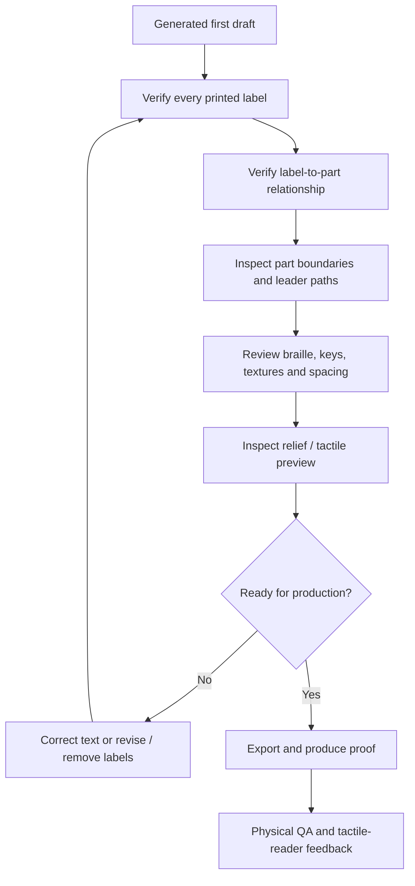

# Transcriber review workflow

TactiDiagram produces a first draft. The transcriber verifies the content, corrects machine errors, and decides whether the page is ready for production. The automated pipeline is not a substitute for professional transcription judgment or tactile-reader testing.

## Review sequence

## Fixing labels

Every detected label is listed with its braille rendering and status information:

- **Braille placement:** full braille or a two-letter key.
- **Leader relationship:** leader traced or label located on the part.
- **Segmentation:** part segmented or no part found.
- **OCR corrections:** likely spelling corrections checked against the science vocabulary.

Corrections such as `Atriym` → `Atrium` or `Leff Atrium` → `Left Atrium` should always be checked against the source. A plausible spelling is not proof that the word is correct in context.

Actions per label:

- **Edit text:** correct the wording; the braille and layout update.
- **Merge:** join a label split across multiple OCR lines.
- **Remove / restore:** exclude an incorrect or irrelevant label, or restore it.

The current UI does not provide a general workflow for adding a label that OCR entirely missed. If a required label is absent, record it as a limitation rather than assuming the generated graphic is complete.

## Inspect the analysis views

- **Tactile graphic:** inspect the final tactile layout. Hovering a label highlights its braille and associated bold outline.
- **What the AI saw:** inspect the OCR box, leader line, and segmentation mask over the source image.
- **vs. edge tracing:** compare the label-guided result with the Canny edge-tracing baseline at the same page size.
- **Key page:** verify that every key is unique, legible, and correctly associated with the intended label.
- **3D relief:** rotate and inspect the raised geometry under the simulated raking light. This is a visualization aid, not a physical proof.

## Guideline checks

The checker reports selected geometric properties alongside the edge-tracing baseline:

- print text that remains as raised marks (target: none)
- fragments shorter than 12.5 mm
- proportion of figure area where lines are closer than 3 mm
- braille labels with the intended 3 mm clearance

Treat a flagged value as a reason to inspect the drawing. A low metric does not prove that the tactile graphic is understandable, and a high metric does not automatically mean that a particular line should be removed. Meaning and tactile legibility matter.

## Final review checklist

Before exporting, verify:

1. Every printed label is present, spelled correctly, and represented in braille or the key.
2. Every label points to the intended part; leader tips and segmentation masks agree with the source.
3. No letterforms, shading artifacts, borders, or irrelevant decoration have become tactile lines.
4. Important outlines and internal features are distinguishable by line hierarchy.
5. Textures are distinct, consistently assigned, and do not crowd boundaries.
6. Braille is correct, oriented correctly, and has adequate clearance.
7. The page title, key page, orientation, and page size are correct.
8. The 3D preview and automated checks have been inspected, with exceptions resolved or documented.

## Production proof

Export the tactile SVG or print/PDF and produce a proof using the actual swell-paper and fuser workflow. Inspect the physical result; on-screen geometry cannot model every printer, paper, fuser, or environmental variation. Where possible, obtain feedback from intended tactile readers and revise accordingly. See [Printing and swell paper](printing.md).

## Editable SVG post-processing and quality control

The tactile SVG export is a vector document with physical dimensions in millimetres. It contains separate, named SVG groups for the page background, textures, structural line art, outlines, label-clearance knockouts, leader lines, and braille dots. The key-page SVG also separates braille from sighted print-reference text. Paths, circles, and text remain vector objects rather than a flattened screenshot.

**Inkscape is the recommended reference editor because it is free and open-source (FOSS).** The exported SVG is standard vector artwork; other SVG-capable editors—including Adobe Illustrator and Affinity Designer—can also be used. TactiDiagram targets FOSS workflows, so Inkscape is the editor used in these instructions, not a technical requirement.

Recommended post-processing sequence:

1. Export the editable tactile SVG and, when present, the key-page SVG.
2. Open the SVG in Inkscape. Use the Objects/Layers panel to inspect and isolate the named groups.
3. Compare the artwork with the source diagram and the TactiDiagram analysis views. Correct path geometry, remove false contours, reconnect broken boundaries, and adjust leader placement where necessary.
4. Check label-to-part correspondence, braille spelling and dot patterns, line hierarchy, texture distinction, clearances, and page margins. Do not assume that a visually attractive edit is tactilely legible.
5. Preserve the physical page dimensions and millimetre scale. Avoid scaling individual objects in ways that alter specified braille or line dimensions.
6. Save a separate reviewed SVG, then produce a physical proof on the target printer/swell-paper/fuser system. Inspect the raised output and obtain tactile-reader feedback where possible.

The vector editor is a post-processing and QC option, not an automated validation step. Editing SVG geometry does not update TactiDiagram's analysis state or its automated guideline report. Re-run or independently perform checks after edits, and retain the unmodified export so changes can be compared or reverted.

## Reviewing Autotrace preprocessing

When **Use Autotrace (Potrace)** is enabled, the reconstructed raster becomes the input to OCR, leader detection, foreground/structural-line analysis, and SAM segmentation. Compare **What the AI saw** with the untouched **Original** view. Look for lost pale outlines, merged neighbouring features, changed label recognition, and leader endpoints that no longer land on the intended part. A better-looking raster is not necessarily a more accurate analysis input; verify the label-to-part relationships again after every Autotrace run.

## Reviewing direct Potrace output

When **Use direct Potrace SVG output (full analysis)** is enabled, do not treat the direct trace as a substitute for the analysis views. The full OCR, leader, foreground, and SAM segmentation pipeline still runs, but the primary SVG artwork is traced from the original source image rather than rendered from the part masks.

Review the direct mode separately:

1. Compare the transparent black outline trace with the untouched Original view. Look for missing pale boundaries, excess internal colour boundaries, false contours, and details simplified by Potrace.
2. Confirm that OCR-masked label areas have not removed nearby meaningful linework. The mask intentionally suppresses printed glyphs and a small surrounding margin.
3. Check each braille layer against the source wording and the standard analysis association. In the layered SVG, Potrace linework, title, and each label can be selected and moved independently.
4. If **Use letter keys for every label** is on, verify every two-letter key is unique and the key page maps it to the correct full label. Confirm that the key page is included in print/PDF output.
5. Remember that geometric checks are computed from analysis/layout data, not a tactile validation of direct Potrace paths. Recheck edited paths and braille after vector-editor changes.

The direct SVG is transparent by design. An editor may display transparency against a checkerboard or its page colour; this does not mean a background has been embedded. The standard segmented export remains available by turning off direct Potrace output and rerunning analysis.
